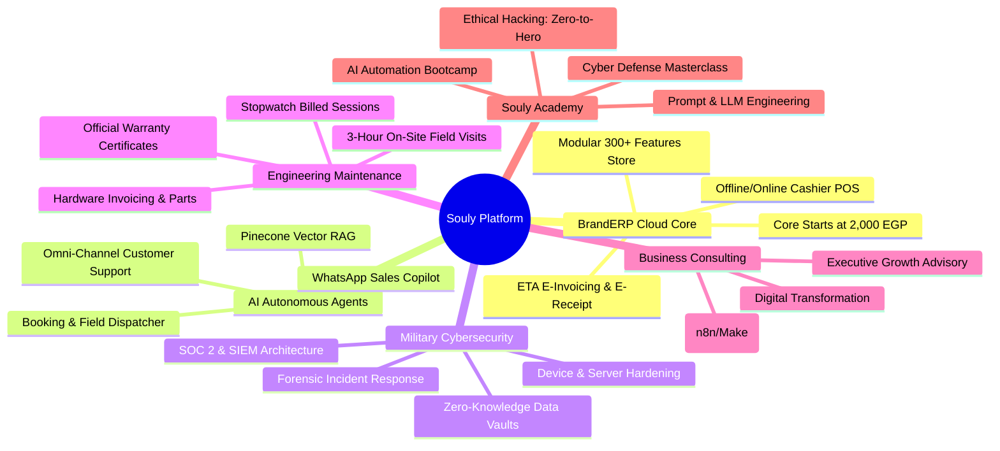

<p align="center">
  
</p>

<h1 align="center">🦅 SOULY PLATFORM · مَنظُومَة سُولِي الرَّقَمِيَّة</h1>

<p align="center">
  <strong>The Sovereign Enterprise Digital Ecosystem & Cyber HUD Platform</strong><br>
  Built on Laravel 11/13, PHP 8.3, Tailwind CSS 4, Alpine.js, Vanilla ES6+ Modules, and Google Gemini AI.<br>
  Engineered for <strong>sub-1% CPU Lonex shared hosting</strong> with <strong>0ms client-side IndexedDB hydration</strong>.
</p>

<p align="center">
  <a href="https://soulyeg.online"></a>
  <a href="https://php.net"></a>
  <a href="https://laravel.com"></a>
  <a href="https://tailwindcss.com"></a>
  <a href="https://ai.google.dev"></a>
  <a href="https://accept.paymob.com"></a>
</p>

---

## 📑 Table of Contents

1. [Executive Overview](#-executive-overview)
2. [The 6 Sovereign Business Sectors](#-the-6-sovereign-business-sectors)
3. [Key Architectural Innovations](#-key-architectural-innovations)
4. [Sovereign AI Agent & Key Pool Failover](#-sovereign-ai-agent--key-pool-failover)
5. [Standalone Marketplaces & Commerce](#-standalone-marketplaces--commerce)
6. [Client Portal & Admin Headquarters](#-client-portal--admin-headquarters)
7. [Default Seeded Accounts & Credentials](#-default-seeded-accounts--credentials)
8. [Local Installation & Setup Guide](#-local-installation--setup-guide)
9. [Automated Lonex Production Deployment](#-automated-lonex-production-deployment)
10. [Automated Testing Suite](#-automated-testing-suite)
11. [Detailed Documentation Suite](#-detailed-documentation-suite)
12. [License & Intellectual Property](#-license--intellectual-property)

---

## 🏛 Executive Overview

**Souly Platform (سولي للحلول والأنظمة الرقمية)** is an enterprise-grade digital fortress that unifies trade management, autonomous artificial intelligence, defensive cybersecurity, engineering field services, executive consulting, and technical education into one cohesive, cinematic platform.

Designed to overcome the performance constraints of budget shared hosting (specifically **Lonex** cPanel infrastructure), Souly combines a monolithic server architecture with client-side reactive components:
* **Cyber HUD Visual System:** Obsidian dark theme (`#05050A`), animated SVG radar reticles, glowing neon borders (`#00F5D4`, `#7B2CBF`, `#FFB800`, `#FF2A55`), and strict Cairo/Tahoma Arabic typography.
* **0ms Real-Time Feature Popups:** 130+ service icons and technical bullet points are hydrated into client `IndexedDB` on the first visit, ensuring zero latency on modal opens.
* **Progressive Web App (PWA):** Installs as a standalone native app on iOS Safari and Android Chrome with complete offline fallback handling.

---

## ⚡ The 6 Sovereign Business Sectors

Every sector features official Egyptian Pound (EGP) transparent pricing, warranty certificates, and custom interactive simulators:



### Summary Matrix of Sectors & Packages:

| Sector | Slug | Min Price | Package Highlight | Official Warranty | Interactive Simulator |
| :--- | :--- | :---: | :--- | :---: | :--- |
| **1. BrandERP Cloud Core** | `brand-erp` | **2,000 ج.م** | كاشير POS أوفلاين + فاتورة إلكترونية معتمدة | 30 - 365 يوماً | [ROI & Sales Calculator](docs/SERVICES_CATALOG.md#3-the-6-interactive-simulators) |
| **2. AI Autonomous Agents** | `ai-agents` | **3,500 ج.م/ش** | موظفو مبيعات ودعم ذكيين عبر واتساب | 30 - 90 يوماً | [Live Conversation Simulator](docs/SERVICES_CATALOG.md#3-the-6-interactive-simulators) |
| **3. Military Cybersecurity** | `cybersecurity` | **1,500 ج.م** | تدريع وحماية متقدمة للأجهزة والسيرفرات | 30 - 180 يوماً | [Cyber Vulnerability Scanner](docs/SERVICES_CATALOG.md#3-the-6-interactive-simulators) |
| **4. Engineering Maintenance** | `maintenance` | **1,200 ج.م** | زيارات ميدانية مهندسين (3 ساعات بمقرك بخصم 50%) | 14 - 60 يوماً | [Cost & Hourly Benchmark](docs/SERVICES_CATALOG.md#3-the-6-interactive-simulators) |
| **5. Business Consulting** | `business-consulting` | **7,500 ج.م** | إعادة هندسة العمليات وأتمتة مسارات العمل | تنفيذ 100% | [Diagnostic Maturity Assessment](docs/SERVICES_CATALOG.md#3-the-6-interactive-simulators) |
| **6. Souly Academy** | `academy` | **4,000 ج.م** | معسكرات تدريبية واحتراف عملي مباشر | شهادة معتمدة | [Curriculum & Lab Explorer](docs/SERVICES_CATALOG.md#3-the-6-interactive-simulators) |

---

## 🧬 Key Architectural Innovations

### 1. 0ms Client-Side IndexedDB Hydration
Instead of bloating the server HTML response with data for 130+ feature modals, the homepage and service subpages load a lightweight cached JSON payload from `GET /api/catalog/icons` on first visit. The data is stored in the browser's `IndexedDB` (`SoulyCitadelDB`), enabling instantaneous, zero-server-roundtrip modal popups.

### 2. Autonomous 1-Tap Undo Action Snapshots
Any write or update operation triggered by the Sovereign AI Agent or Admin tools records an atomic snapshot in `ai_action_snapshots` containing serialized `before_state_json` and `after_state_json`. Operators can undo any action (such as an incorrect price change or lead status) with a single click.

### 3. Egyptian Phone & Currency Normalization
Unstructured visitor inputs (e.g. `01012345678`, `+20 11 99887766`, `٠١٢٣٤٥٦٧٨٩٠`) are standardized into canonical E.164 format (`+201012345678`) via `NormalizesEgyptianPhone`, preventing duplicate CRM leads and broken WhatsApp links.

---

## 🤖 Sovereign AI Agent & Key Pool Failover

The platform embeds a dual AI architecture:
* **Visitor Chat Widget (`SoulyAiService`):** Embeds in the bottom right corner with animated fluid glass morphing. Connects to Pinecone Vector DB to answer customer inquiries and detect sales leads.
* **Citadel Admin Copilot (`AdminSovereignAgentService`):** Operates at `/admin/ai-copilot` to execute autonomous business actions:
  * Morning briefing summaries (`getMorningBriefing`).
  * 1-tap booking call confirmations (`toggleBookingCallConfirmed`).
  * Hardware product price and stock updates (`updateHardwareProduct`).
  * Instant lead and booking dossier extraction from raw chat text (`createDossierFromChat`).
* **Multi-Key Failover Pool (`SoulyAiKeyPoolService`):** Monitors API keys in `ai_api_keys`. If rate-limited (429), it automatically puts the key into cooldown and seamlessly switches to the next available key without interrupting operations.

---

## 🛒 Standalone Marketplaces & Commerce

1. **BrandERP Modular Marketplace (`/store/branderp`):**
   * Catalog of 500 features across Core, 12 Major Modules, and Micro-Features.
   * Instant 14-day free trial provisioning (`POST /store/branderp/trial`).
   * Custom module requests with file upload (`POST /store/branderp/custom-request`).
   * Branded quote PDF export with ROI calculations (`GET /store/branderp/quotation`).
2. **Hardware & Equipment Store (`/store/hardware`):**
   * High-speed thermal printers, touch POS terminals, barcode scanners, and enterprise servers.
   * Real-time stock decrement and flash deal badges.
   * Direct transfer or instant wallet-balance checkout.
3. **Financial Wallet Subsystem (`/portal/wallet` & `/admin/wallets`):**
   * Atomic balance ledger with row locking (`lockForUpdate()`).
   * Paymob card & mobile wallet integration with SHA-512 HMAC verification.
   * Administrative treasury approval and promotional bonus top-ups.

---

## 🛡 Client Portal & Admin Headquarters

### Client Portal (`/portal`):
* **Devices Hub (`/portal/devices`):** Register corporate hardware assets with photos and trigger 1-tap maintenance visits.
* **Bookings Hub (`/portal/bookings`):** Track engineer assignments, download tax invoices and engineering warranty certificates.
* **Invoices & Warranties (`/portal/invoices`):** Public QR-code verification link (`/invoice/verify/{hash_id}`).
* **Support Desk (`/portal/tickets`):** Interactive ticketing with isolated client/staff messaging channels.

### Admin Command Center (`/admin`):
* **Mini-CRM Pipeline (`/admin/leads`):** 4-stage lead tracking, call confirmation toggles, and conversion into active client accounts.
* **Stopwatch Field Operations (`/admin/bookings`):** On-site technician stopwatch with hourly billing and parts pricing.
* **Smart Canned Responses Vault (`/admin/canned-responses`):** 28 seeded quick responses across 7 categories with slide-out drawer integration.
* **Host Operations & Logs (`/admin/host-ops`):** Web-based Artisan command executor, log viewer, and 1-tap database backup exports.

---

## 👥 Default Seeded Accounts & Credentials

The database seeder pre-provisions four primary testing accounts across the RBAC hierarchy:

| Role | Email | Password | Pre-loaded Balance | Permissions |
| :--- | :--- | :--- | :---: | :--- |
| **Administrator** | `admin@soulyeg.online` | `Password123!` | **50,000.00 ج.م** | Full Sovereign Citadel Access (`/admin/*`) |
| **Operations Staff** | `staff@soulyeg.online` | `Password123!` | 0.00 ج.م | CRM, Tickets, Bookings & Canned Vault |
| **Field Technician** | `tech@soulyeg.online` | `Password123!` | 0.00 ج.م | Stopwatch Field Visits & Device Diagnostics |
| **Demo Client** | `client@soulyeg.online` | `Password123!` | **10,000.00 ج.م** | Client Portal, Orders, Devices & Invoices |

> [!NOTE]  
> In local development environments (`APP_ENV=local` and `APP_DEBUG=true`), quick 1-tap demo logins are accessible directly at `/login` or via `POST /login/demo/{role}`.

---

## 💻 Local Installation & Setup Guide

### System Prerequisites:
* PHP **8.3.0** or higher (with `pdo_mysql`, `mbstring`, `openssl`, `curl`, `gd`, `fileinfo` extensions enabled)
* MySQL **8.0+** or MariaDB **10.5+**
* Composer **2.5+**
* Node.js **18+** & NPM

### Step-by-Step Setup:

```bash
# 1. Clone the repository
git clone https://github.com/hedrafox5-lang/soulyplatform.git
cd soulyplatform

# 2. Install PHP and Composer dependencies
composer install

# 3. Setup environment configuration
cp .env.example .env

# 4. Generate unique application cryptographic key
php artisan key:generate

# 5. Create local database in MySQL
mysql -u root -e "CREATE DATABASE IF NOT EXISTS souly_citadel_db CHARACTER SET utf8mb4 COLLATE utf8mb4_unicode_ci;"

# 6. Run database migrations and seed full catalog data
php artisan migrate --seed

# 7. Symlink public storage for uploads
php artisan storage:link

# 8. Install and build frontend assets
npm install
npm run build

# 9. Start the development server
php artisan serve
```

Access the application in your browser at:  
👉 **`http://localhost:8000`**

---

## 🚀 Automated Lonex Production Deployment

Deploying on Lonex or restricted cPanel hosting requires zero SSH root access:

### Method A: Terminal Execution (Recommended on SSH)
```bash
bash deploy-lonex.sh
```
*Or directly via Artisan:*
```bash
php artisan souly:deploy
```

### Method B: Zero-Terminal Web Deployment
If SSH access is restricted, trigger deployment securely from the browser:
```text
https://soulyeg.online/run-souly-deploy-now?token=YOUR_DEPLOY_SECRET
```
*Or run safe Artisan maintenance commands:*
```text
https://soulyeg.online/run-souly-artisan?token=YOUR_DEPLOY_SECRET
```

---

## 🧪 Automated Testing Suite

The project includes automated feature and unit tests validating database relationships, UI security, simulators, stores, and deployment optimization:

```bash
# Run the complete test suite
php artisan test

# Run a specific feature test suite
php artisan test --filter=Phase2DatabaseArchitectureTest
php artisan test --filter=FrontendUxAndAnimationPolishTest
php artisan test --filter=HardwareStoreAndTicketScopeFullSuiteTest
```

---

## 📚 Detailed Documentation Suite

Deep-dive documentation is maintained in the [`docs/`](docs/) directory:

* 🏛 [**System Architecture & Technical Design (`docs/ARCHITECTURE.md`)**](docs/ARCHITECTURE.md): Multi-tier layer design, database ERD, security hardening, and IndexedDB performance.
* 📦 [**Services Catalog & Simulators Directory (`docs/SERVICES_CATALOG.md`)**](docs/SERVICES_CATALOG.md): Breakdown of the 6 sectors, 24 packages, pricing models, and 6 interactive simulators.
* 🤖 [**AI Agent Engine & Sovereign Copilot (`docs/AI_AGENT_ENGINE.md`)**](docs/AI_AGENT_ENGINE.md): Gemini key pool failover, Pinecone RAG, 1-tap undo snapshot engine, and CRM lead extraction.
* 🛒 [**Stores, Commerce & Financial Ledger (`docs/STORES_AND_COMMERCE.md`)**](docs/STORES_AND_COMMERCE.md): BrandERP modular marketplace, POS hardware store, digital wallet atomicity, and Paymob payment webhooks.
* 🛡 [**Client Portal & Admin Headquarters (`docs/CLIENT_AND_ADMIN_PORTALS.md`)**](docs/CLIENT_AND_ADMIN_PORTALS.md): Registered device assets, stopwatch field operations, smart canned response vault, and database backup exports.
* 🚀 [**Deployment & Lonex Hosting Guide (`docs/DEPLOYMENT_AND_LONEX.md`)**](docs/DEPLOYMENT_AND_LONEX.md): Zero-terminal web deployment, `souly:deploy` command, and `.htaccess` optimization.
* 🔌 [**API Reference & Integrations (`docs/API_AND_INTEGRATIONS.md`)**](docs/API_AND_INTEGRATIONS.md): REST endpoints for AI chat, 0ms catalog icons, express booking, and public invoice QR verification.
* 📋 [**Forensic Audit Report (`SOULY_AUDIT_REPORT.md`)**](SOULY_AUDIT_REPORT.md): Official forensic audit sign-off and production verification.

---

## ⚖ License & Intellectual Property

Copyright © 2026 **Souly Digital Systems & Technologies (مؤسسة سولي للتكنولوجيا والأنظمة)**.  
All rights reserved. Proprietary software licensed exclusively for official Souly Citadel enterprise deployments.
