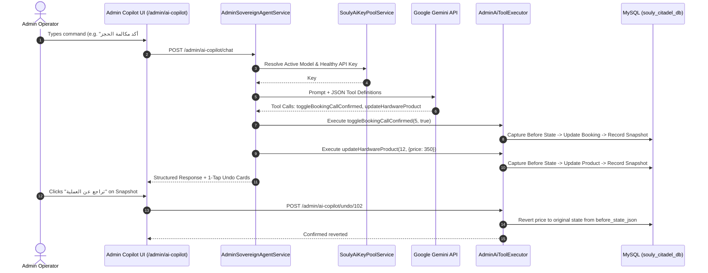

# Souly Platform — AI Agent Engine & Sovereign Copilot

> **Mission:** Deliver enterprise-grade conversational AI for visitors and autonomous administrative tooling for operators, guarded by failover pools, semantic vector retrieval (RAG), and 1-tap undo snapshots.

---

## 1. Architectural Highlights

The Souly AI subsystem operates on a dual-engine architecture:
1. **Public Visitor Agent (`AiAgentController` & `SoulyAiService`):**
   * Embeds directly onto the homepage and service subpages via `resources/views/partials/souly-ai-widget.blade.php`.
   * Leverages Pinecone Vector Database (`souly-knowledge-v1`) to retrieve accurate service specs, package pricing, and warranty terms.
   * Recognizes Egyptian phone numbers and auto-creates leads in the CRM (`App\Models\Lead`).
2. **Administrative Sovereign Agent (`AdminAiCopilotController`, `AdminSovereignAgentService`, `AdminAiToolExecutor`):**
   * Accessible in the Citadel Admin Headquarters at `/admin/ai-copilot`.
   * Equipped with autonomous database read/write tools.
   * Logs every mutating action to `ai_action_snapshots` for instantaneous rollback.



---

## 2. Dynamic Key Pool Failover (`SoulyAiKeyPoolService`)

To eliminate API downtime and avoid strict Google Gemini rate limits (RPM / TPM), keys are managed dynamically in database table `ai_api_keys`:

### 2.1 Schema Attributes (`AiApiKey`):
* `provider`: `'gemini'` | `'pinecone'` | `'openai'`
* `api_key`: Encrypted or raw secret string
* `status`: `'active'` | `'cooldown'` | `'disabled'` | `'exhausted'`
* `priority`: Integer sorting (1 = primary, 2 = secondary, etc.)
* `cooldown_until`: Timestamp marking when a throttled key can be retried
* `requests_today`: Real-time invocation counter
* `scope`: `'all'` | `'admin_only'` | `'visitor_only'`

### 2.2 Transparent Fallback & Model Resolution:
* Primary Model: `gemini-3.8-flash` (or custom setting in `Setting::get('ai_admin_model')`).
* Fallback 1: `gemini-2.5-flash`
* Fallback 2: `gemini-1.5-flash`
* If a 429 (Rate Limit) or 403 (Invalid Key) is received, the service marks the offending key in `cooldown` for 10 minutes, immediately switches to the next priority candidate, and replays the request without failing the user's action.

---

## 3. Autonomous Tool Executor (`AdminAiToolExecutor`)

The sovereign agent can execute the following actions autonomously when authorized by administrative prompts:

| Tool Name | Parameters | Action Taken | Snapshot Logged |
| :--- | :--- | :--- | :---: |
| `getMorningBriefing` | None | Aggregates daily new bookings, unpaid transactions, pending leads, and low-stock hardware. | No (Read-Only) |
| `toggleBookingCallConfirmed` | `bookingId`, `confirmed` | Updates booking phone verification status and logs call timestamp. | **Yes** |
| `updateBookingStage` | `bookingId`, `stage` | Progresses booking through stages (`initial_contact`, `site_scheduled`, `in_progress`, `completed`). | **Yes** |
| `updateHardwareProduct` | `productId`, `data` | Modifies hardware price, stock quantity, flash deal status, or technical specifications. | **Yes** |
| `updateErpFeature` | `featureId`, `data` | Updates BrandERP module pricing, activation count, or ROI time-saved text. | **Yes** |
| `approveWalletDeposit` | `transactionId` | Atomically credits client wallet balance and marks transaction approved. | **Yes** |
| `adjustClientWallet` | `userId`, `amount`, `reason` | Issues manual debit or promotional credit with detailed auditing reason. | **Yes** |
| `createDossierFromChat` | `parsedData` | Parses raw chat copy-paste into CRM lead, booking, and technical requirements. | **Yes** |

---

## 4. The 1-Tap Undo Action Snapshot Engine

Every mutating operation performed by the AI agent generates a record in `ai_action_snapshots`:

```json
{
  "id": 102,
  "admin_id": 1,
  "action_type": "update",
  "target_table": "hardware_products",
  "target_id": 14,
  "before_state_json": {
    "price": 450.00,
    "stock_quantity": 25,
    "is_flash_deal": 0
  },
  "after_state_json": {
    "price": 350.00,
    "stock_quantity": 25,
    "is_flash_deal": 1
  },
  "description_ar": "تخفيض سعر منتج طابعة الفواتير الحرارية وإدراجه في العروض الخاطفة",
  "is_reverted": false,
  "created_at": "2026-11-05T12:30:00Z"
}
```

### Rollback Logic (`revertSnapshot($snapshotId)`):
1. **Create Action:** Deletes the record by primary ID from the target table.
2. **Update Action:** Restores original values directly from `before_state_json`.
3. **Delete Action:** Re-inserts the deleted record matching `before_state_json`.
4. Marks `is_reverted = true` to prevent double-reversal.

---

## 5. Egyptian Phone Normalization & CRM Extraction

The system utilizes `App\Services\NormalizesEgyptianPhone` (and matching trait) to parse unstructured visitor messages:

* Supported input formats:
  * `01012345678` -> Normalized to `+201012345678`
  * `+20 11 98765432` -> Normalized to `+201198765432`
  * `٠١٢٣٤٥٦٧٨٩٠` (Arabic-Indic numerals) -> Converted to standard digits
* When a visitor mentions their phone number in the web chat widget, the agent automatically:
  1. Captures the phone number.
  2. Extracts intent (e.g. interested in `brand-erp` Starter package).
  3. Creates a record in `leads` table with `source = 'ai_agent'`.
  4. Dispatches an in-app notification to Citadel sales operators.
