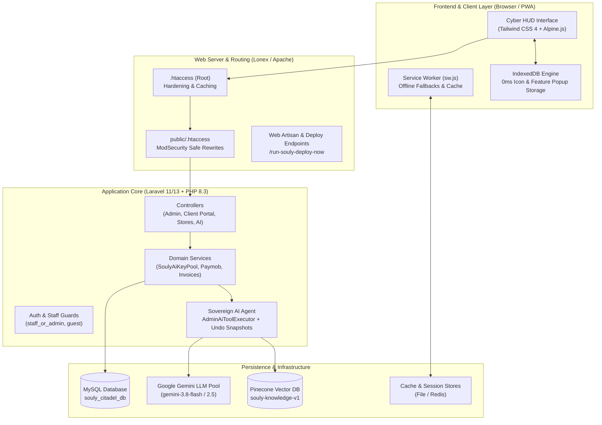
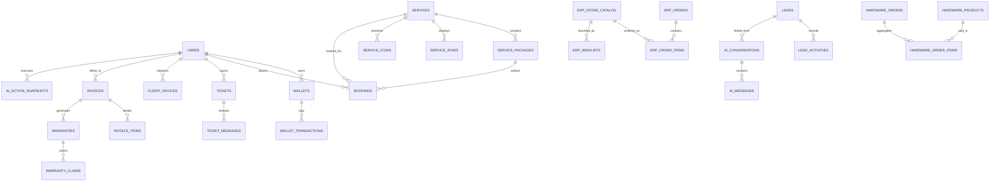

# Souly Platform — Architecture & Technical Specifications

> **System Designation:** Souly Platform (سولي للحلول والأنظمة الرقمية)  
> **Production Domain:** [soulyeg.online](https://soulyeg.online)  
> **Framework Stack:** Laravel 11 / 13 (PHP 8.3+), Tailwind CSS 4, Alpine.js, Vanilla ES6+ Modules, MySQL 8 / MariaDB  
> **Architectural Paradigm:** Monolithic Cyber HUD with Modular Micro-Stores, Sovereign AI Copilot, and Edge Caching  

---

## 1. System Overview & Core Philosophy

Souly Platform is an enterprise digital ecosystem engineered to unify six critical technical sectors into a cohesive, high-performance web experience. Designed specifically to thrive under shared and restricted cPanel hosting environments (notably **Lonex**) while delivering modern Single-Page Application (SPA) responsiveness, Souly integrates:

1. **Front-Facing Cyber HUD Experience:** Futuristic dark-mode aesthetic (`#05050A`, Cyan `#00F5D4`, Purple `#7B2CBF`, Gold `#FFB800`) strictly typed with Cairo and Tahoma Arabic fonts.
2. **0ms Client Catalog Hydration:** Powered by `IndexedDB` and a lightweight cached API (`/api/catalog/icons`) ensuring instantaneous popup retrieval without page bloat.
3. **Modular Commerce Subsystems:** Standalone BrandERP module store (+300 micro-features) and POS Hardware equipment store.
4. **Autonomous AI Sovereign Agent:** Multi-provider failover pool (Google Gemini & Pinecone RAG) capable of read/write administrative tasks with 1-tap undo capability.
5. **Atomic Financial Engine:** Client digital wallets, multi-channel payment gateways (Paymob, Vodafone Cash, Bank Transfer), automated invoice generation, and SHA-256 verified warranty certificates.

---

## 2. Multi-Tier Layer Architecture

### 2.1 Presentation & UI Layer
* **Blade Templating Structure:**
  * `layouts/master.blade.php`: The foundational HTML shell containing PWA manifests, Arabic SEO metadata, OpenGraph tags, JSON-LD schema, and universal assets.
  * `layouts/desktop.blade.php`: Desktop-optimized shell with sticky header, context menu listener, keyboard command palette (`Cmd/Ctrl + K`), and collapsible tactical HUD dock.
  * `layouts/mobile.blade.php`: Mobile SuperApp shell featuring native swipeable bottom sheets, sticky action docks, quick story pills, and iOS Safari zoom prevention (`font-size >= 16px`).
* **Design Tokens & Color Palette:**
  * Background Obsidian: `#05050A` (Deepest Void), `#0B0C16` (Surface 1), `#121422` (Surface 2), `#16192E` (Surface 3)
  * Neon Accents: `#00F5D4` (Cyber Cyan), `#7B2CBF` (Cyber Purple), `#FFB800` (Cyber Amber), `#FF2A55` (Crimson Alert)
  * Typography: `font-cairo` for Arabic headings and body text; `font-mono` / `Tahoma` for numbers, codes, and tabular data.

### 2.2 Client-Side Storage & Performance Engine
* **`public/js/souly-storage.js`:** Manages client-side storage abstractions. Initializes an `IndexedDB` database (`SoulyCitadelDB`, store: `catalog_icons`) to cache 130+ service icons and detailed feature bullet points.
* **`public/js/souly-loader.js`:** Controls universal loading animations, top telemetry neon progress bars, and cinematic transitions.
* **`public/js/souly-ui.js` & `souly-bundle.js`:** Handles Alpine.js stores (`$store.citadel`), context menu positioning, modal focus management, and quick dock expansion.

### 2.3 Application & Business Logic Layer
* **Namespace Structure (`app/`):**
  * `App\Http\Controllers\`: Public marketing, stores, express booking, and client portal controllers.
  * `App\Http\Controllers\Admin\`: Administrative command center controllers guarded by `staff_or_admin` middleware.
  * `App\Services\`: Encapsulated domain logic:
    * `SoulyAiKeyPoolService`: Manages API key failover, rate limits, cooldowns, and model resolution.
    * `AdminSovereignAgentService` & `AdminAiToolExecutor`: Autonomous administrative tool execution with snapshot logging.
    * `PaymentGatewayService` & `PaymobPaymentService`: Paymob Iframe/Webhook HMAC calculation and token issuance.
    * `SoulyNotificationService`: Cross-platform unread notification dispatcher.
    * `NormalizesEgyptianPhone`: Standardizes phone formats across Egypt (`+2010...`, `011...`).

---

## 3. Database Architecture & Schema Deep-Dive

The database is built on relational integrity (`InnoDB`, `utf8mb4_unicode_ci`) across 16 core domains:

### 3.1 Domain Breakdown

| Domain | Primary Tables | Responsibility |
| :--- | :--- | :--- |
| **Identity & Access** | `users`, `sessions` | RBAC roles (`admin`, `staff`, `client`, `technician`), profile data, security timestamps. |
| **Financial Ledger** | `wallets`, `wallet_transactions` | Atomic balance storage, transaction reference tracking, manual approvals, bonus credits. |
| **Service Catalog** | `services`, `service_packages`, `service_rows`, `service_icons` | The 6 core sectors, 24 packages, before/after comparative rows, and 130 interactive feature icons. |
| **Field Operations** | `bookings` | Scheduling, field engineer assignment, stopwatch tracking (`visit_started_at`, `visit_ended_at`), hourly rates, parts JSON. |
| **Support Desk** | `tickets`, `ticket_messages` | Departmental ticketing (`erp`, `hardware`, `maintenance`, `cyber`, `consulting`), internal staff notes. |
| **Mini-CRM Pipeline** | `leads`, `lead_activities` | Lead intake, Egyptian phone normalization, pipeline stages (`initial_contact`, `quoted`, `won`, `lost`). |
| **Response Vault** | `canned_responses`, `canned_response_categories` | 7 consolidated categories with 28 seeded customer service responses and usage analytics. |
| **Conversational AI** | `ai_conversations`, `ai_messages` | Visitor session identity (`visitor_uuid`, IP, User-Agent), sentiment logging, lead extraction. |
| **AI Infrastructure** | `ai_api_keys`, `ai_action_snapshots` | Key pool failover, cooldown timers, request quotas, and 1-tap undo before/after snapshots. |
| **BrandERP Store** | `erp_store_catalog`, `erp_orders`, `erp_order_items`, `erp_wishlists`, `erp_custom_requests`, `erp_sales_proposals` | 500 feature catalog, micro-tiers, instant quote exports, 14-day trials. |
| **Hardware Store** | `hardware_products`, `hardware_orders`, `hardware_order_items` | POS & network inventory, stock tracking, inline price updates, order status pipelines. |
| **Client Assets** | `client_devices` | Registered client hardware, serial numbers, fault descriptions, maintenance requests, photos. |
| **Billing & Warranty** | `invoices`, `invoice_items`, `warranties`, `warranty_claims` | SHA-256 public QR verification, official PDF exports, warranty expiry tracking, RMA claims. |
| **Notifications** | `notifications` | In-app alerts, unread counts, action links for clients, engineers, and admins. |
| **System Settings** | `settings` | Dynamic key-value configuration (WhatsApp templates, Pinecone credentials, active LLM model). |

---

## 4. Security & Hardening Architecture

1. **Strict Role-Based Access Control (RBAC):**
   * Guarded via `staff_or_admin` middleware.
   * Administrative endpoints reject unauthorized users with 403 or redirect to login.
   * Client portal routes strictly verify resource ownership (`$invoice->user_id === Auth::id()`).
2. **Lonex & ModSecurity Compliance:**
   * AJAX endpoints strictly parse clean JSON to prevent Apache ModSecurity false positives.
   * Root `.htaccess` enforces SSL (`HTTPS`), disables directory browsing (`Options -Indexes`), and sets security headers:
     * `X-Content-Type-Options: nosniff`
     * `X-Frame-Options: SAMEORIGIN`
     * `X-XSS-Protection: 1; mode=block`
     * `Referrer-Policy: strict-origin-when-cross-origin`
3. **Financial Atomicity:**
   * Wallet deposits and booking deductions execute within atomic database transactions (`DB::beginTransaction() ... DB::commit()`).
   * Race conditions prevented using database row locking (`lockForUpdate()`).
4. **Autonomous AI Safeguards:**
   * Sovereign AI write actions are intercepted by `AdminAiToolExecutor`.
   * Complete serialized before-and-after state snapshots are stored in `ai_action_snapshots`, enabling instant 1-tap administrative reversals.
