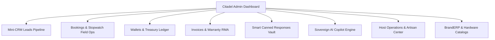

# Souly Platform — Client Portal & Admin Headquarters

> **Architecture:** Role-tailored interfaces separating client self-service operations from administrative mission control.

---

## 1. Client Portal (`/portal`)

The Client Portal provides a streamlined, dark-mode dashboard tailored for corporate clients and individual consumers:

### 1.1 Registered Device Asset Management (`/portal/devices`)
* **Asset Tracking:** Clients register corporate laptops, PCs, POS terminals, and servers.
* **Fields:** Model number, serial number, technical specifications, and condition status (`healthy` or `needs_maintenance`).
* **Photo Attachments:** Upload up to 5 photos showing hardware serial badges or screen faults.
* **1-Tap Maintenance Request:** Dispatches an instant engineering maintenance ticket pre-filled with the device's technical specifications.

### 1.2 Bookings & Field Visits (`/portal/bookings`)
* Schedule on-site hardware maintenance visits or remote consultations.
* Select payment method: Wallet Balance, Direct Bank Transfer, or On-Site Cash to Engineer.
* View assigned field engineer contact details and real-time appointment status.
* Download official **Commercial Invoices** and **Engineering Warranty Certificates** once a visit is marked completed.

### 1.3 Official Invoices & Warranty Verification (`/portal/invoices`)
* Listing of all tax invoices and active hardware warranties.
* QR-code embedded public link (`/invoice/verify/{hash_id}`) verifiable on any smartphone.
* **RMA Warranty Claims:** Submit a claim against an active warranty with fault descriptions.

### 1.4 Technical Support Desk (`/portal/tickets`)
* Categorized support desk (`brand-erp`, `hardware`, `maintenance`, `cybersecurity`, `general`).
* Real-time conversational thread between the client and dedicated engineering staff.
* Upload diagnostic attachments, error screenshots, and configuration logs.

---

## 2. Citadel Admin Headquarters (`/admin`)

The Command Center provides full operational visibility and granular controls over business workflows:

### 2.1 Mini-CRM Leads Pipeline (`/admin/leads`)
* **Kanban & List Pipeline:** Progress leads across 4 distinct stages:
  * `initial_contact` -> `qualified` -> `proposal_sent` -> `converted` (or `lost`).
* **Lead Conversion:** 1-tap conversion turns a CRM lead into a registered client user account with an active wallet.
* **Call Confirmation Toggle:** Instant button marking whether the sales rep has verified requirements via phone call.
* **Activity History:** Chronological timeline tracking calls, meetings, WhatsApp chats, and AI interactions.

### 2.2 Bookings & Field Stopwatch Operations (`/admin/bookings`)
* **Engineer Assignment:** Assign specialized field technicians or remote engineers to client bookings.
* **Live Stopwatch Session:**
  * Engineer clicks **"بدء الزيارة (Start Visit)"** when arriving on-site (`visit_started_at`).
  * Real-time timer calculates billed hours based on minimum 3-hour tier and hourly rates.
  * Engineer inputs spare parts used (`hardware_parts_json`) and labor notes.
  * Clicks **"إنهاء الزيارة (Complete Visit)"** (`visit_ended_at`), generating an official invoice atomically.

### 2.3 Smart Canned Responses Vault (`/admin/canned-responses`)
* **28 Standardized Responses:** Filtered into 7 consolidated categories (`general-welcome`, `erp`, `ai-agents`, `cybersecurity`, `maintenance`, `consulting-academy`, `pricing-objections`).
* **Usage Counters:** Tracks response popularity (`usage_count`) to optimize customer service communication.
* **Quick Drawer API:** Embedded as a slide-out drawer accessible by sales and support staff across all views.

### 2.4 Host Operations & Artisan Center (`/admin/host-ops`)
* Engineered for restricted hosting environments (e.g. Lonex) without root SSH access.
* Run safe Laravel Artisan commands from the UI:
  * `migrate --force`
  * `optimize:clear`
  * `cache:clear`
  * `route:cache`
  * `view:cache`
* **Log Viewer:** Live inspection of `storage/logs/laravel.log` with instant 1-tap clear button.
* **1-Tap Database Backup Snapshot:** Exports a full JSON snapshot of system tables directly from `/admin/system/backup-snapshot`.
