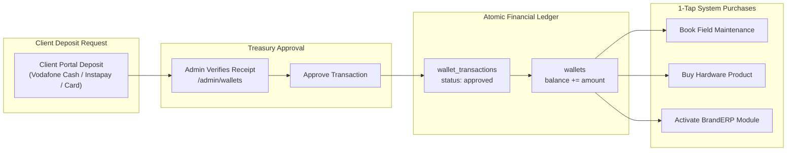

# Souly Platform — Stores, Commerce & Financial Ledger

> **Architecture:** A dual-store ecosystem encompassing the **BrandERP Modular SaaS Marketplace** and the **POS & Hardware Equipment Store**, anchored by a cryptographic digital wallet and Paymob payment integration.

---

## 1. BrandERP Modular SaaS Marketplace (`/store/branderp`)

BrandERP is designed as a modular platform where clients can start with the core cashier nucleus (2,000 ج.م) and dynamically activate specialized features and modules as their business scales.

### 1.1 Structural Tiers (`erp_store_catalog`):
1. **Core Nucleus (`tier = 'core'`):**
   * Foundational system requirements: Cashier POS, inventory, contacts, e-invoicing ETA bridge.
2. **Major Modules (`tier = 'module'`):**
   * 12 enterprise modules including Manufacturing (BOM), Multi-branch sync, Installment accounts, HR & Payroll, Delivery & Fleet, Table reservations, Customer loyalty.
3. **Micro-Features (`tier = 'feature'`):**
   * Over 300 precision features (e.g. WhatsApp invoice auto-send, multi-currency conversion, weighted barcode scanner support, supplier returns management).

### 1.2 Interactive User Actions:
* **Wishlist Toggle (`POST /store/branderp/wishlist`):**
  * Allows authenticated or guest users to bookmark features for customized stack planning.
* **14-Day Free Trial (`POST /store/branderp/trial`):**
  * Instantly provisions an active trial license key (`ERP-TRIAL-XXXX`) tied to the user's account without requiring upfront payment.
* **Instant Quotation PDF / Print (`GET /store/branderp/quotation`):**
  * Generates an official, branded cost estimate calculating total investment, monthly savings, and ROI payback period.
* **Custom Feature Request (`POST /store/branderp/custom-request`):**
  * Enables enterprise clients to submit technical specifications for custom modules. Stored in `erp_custom_requests` and routed to the sales engineering team.

---

## 2. Hardware & POS Equipment Store (`/store/hardware`)

The Hardware Store provides certified equipment pre-configured for BrandERP and enterprise network hardening.

### 2.1 Product Catalog (`hardware_products`):
* Thermal Receipt Printers (USB, LAN, Bluetooth, Wi-Fi)
* Touch POS Terminals & Dual-Screen Cashier Displays
* Barcode & QR Code Scanners (Omnidirectional, Wireless 2.4G)
* Electronic Cash Drawers (Heavy-duty steel, RJ11 auto-trigger)
* Enterprise Network Hardware (Managed gigabit switches, Wi-Fi 6 access points, hardware firewalls)
* High-Performance Workstation Components & NVMe SSDs

### 2.2 Inventory Management & Checkout:
* Real-time stock decrement on purchase (`stock_quantity`).
* Flash deals indicator (`is_flash_deal`) and sales engineer recommendations.
* Two flexible payment options:
  1. **Direct Bank Transfer / Cash on Delivery:** Places order in `pending_verification` state.
  2. **Atomic Wallet Payment:** Deducts balance instantaneously and updates order to `processing` or `shipped`.

---

## 3. Cryptographic Digital Wallet Subsystem

Every registered user (`client`, `staff`, `admin`) receives an individual digital wallet (`wallets` table):

### 3.1 Financial Safety Guarantees:
* All balance increments and deductions run inside `DB::transaction()` with `lockForUpdate()`.
* Every mutation creates an immutable audit row in `wallet_transactions` with unique `reference_code`.
* Wallets can be temporarily locked (`is_locked = true`) by administrators during dispute investigations.
* Promotional bonus credits (`admin/wallets/bonus-gift`) can be granted with custom notes.

---

## 4. Payment Gateway & Paymob Integration

The platform integrates with **Paymob** and unified payment processors through dedicated services:
* Service: `App\Services\PaymobPaymentService` & `App\Services\PaymentGatewayService`
* Webhook Listeners:
  * `POST /payment/callback`
  * `POST /api/paymob/webhook`

### 4.1 Payment Lifecycle:
1. Client selects payment method (Credit/Debit Card or Egyptian Mobile Wallets: Vodafone Cash, Orange Money, Etisalat Cash, WE Pay).
2. Service obtains authentication token and registers merchant order ID.
3. Service generates payment key and returns secure Iframe URL (`https://accept.paymob.com/api/acceptance/iframes/{iframe_id}?payment_token={token}`).
4. Upon customer payment, Paymob transmits a cryptographic HMAC-signed payload to the webhook endpoint.
5. `PaymobWebhookController` verifies the HMAC SHA-512 signature against `PAYMOB_HMAC_SECRET`.
6. Upon validation, the client wallet or order is credited automatically and an in-app notification is dispatched.
